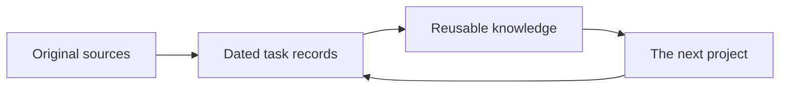

<div align="center">

# 🌱 Moss

**Small notes. Long memory.**

Give Codex a tidy, local Obsidian memory — one useful lesson at a time.

[](https://github.com/andychojh/moss/actions/workflows/test.yml)
[](https://www.python.org/)
[](LICENSE)

</div>

Your agent fixed this last week. Let it remember *why*.

**Explore:** [Open the interactive Korean field guide](https://andychojh.github.io/moss/)
— try setup, revisions, domain colors and ready-to-copy prompts in your browser.
The [downloadable HTML](skills/moss/references/guide.ko.html) also works offline; examples never write to your vault.

Moss is a self-contained Codex skill with **existing-vault adoption, an optional empty vault, guided setup,
standing instructions and a verification command**. It stores dated decisions,
failed approaches and real checks in readable files. Shared principles get one
home; projects keep their own context. **Your work defines the categories.**
New vaults contain no preset domains; names, colors and category count are yours.



## Plant it

Paste this into Codex:

> Install the skill from https://github.com/andychojh/moss/tree/main/skills/moss.
> Use $moss to inspect my existing Obsidian vault and its rules. Propose categories
> that fit my notes, tidy filenames while preserving meaningful dates and identifiers,
> and reorganize with a preview, full backup, updated links and preservation checks.
> Keep my existing vault path, connect relevant notes to project hubs, then enable
> future project memory in Codex and verify it. If I have no vault, create a new one.

You'll need **Python 3.10+** and **Obsidian** to browse the vault. Moss itself uses
only Python's standard library: no pip install, API key or community plugin.
The agent needs permission to read/write your chosen local paths.

After adoption or setup, open the configured folder as a vault in Obsidian and open **Home**.
If the skill is not yet discovered, start a new Codex session and ask for `$moss`.
Skill installation does not execute scripts by itself; the setup request above
is what initializes the vault and connects the instructions.

Prefer explicit-only use? Ask to set up Moss **without standing instructions**.
Manual commands and recovery are in the [setup guide](skills/moss/references/setup.md).

## What grows

| Piece | Purpose |
|---|---|
| **Home + your own areas** | Start uncategorized or choose the categories that fit your work |
| **Project hubs + native Bases** | Browse latest records or the full revision history |
| **Readable records** | `CSV import preserves leading zeros — 2026-01-01.md` |
| **Shared knowledge** | Keep one principle, link its evidence and applications |
| **Canvas + colored graph** | See the structure without flooding it with every log |
| **Migration preview** | See filename/folder changes before activation; retain originals |
| **Setup + doctor** | Connect local paths and instructions, then check structure |

The template is empty. The sample input is **synthetic**, lives outside the vault,
and is never imported by setup. No personal notes, project roots or credentials
are included.

## A normal day

**Start:** “Use $moss to read relevant lessons for this project before we continue.”

**Finish:** “Record what we decided, what failed, what we checked, and what remains uncertain.”

**Connect:** “Find a reusable principle here. Link it to related projects only where the evidence applies.”

With standing instructions enabled, Codex is instructed to do the start/finish
steps at meaningful milestones. It still has to invoke the skill: Moss is not a
background recorder or a guarantee that every agent turn will use memory.

Same input, same task: **no duplicate**. Changed evidence: **a linked revision**.
Old bodies are preserved. “Latest” means last saved, not proven true.

## Your files, your garden

- **Existing vault:** audit → reviewed plan → complete preview → verified activation at the original path, with a full original backup. See [migration](skills/moss/references/existing-vault.md).
- **Fresh start:** setup uses a new/empty vault. No prescribed categories.
- Filenames can be renamed and Markdown notes moved; standard links and Canvas references follow. H1/frontmatter, plugin queries and external incoming links require agent review.
- Existing content is preserved; similar notes are never automatically merged or deleted.
- Existing Codex instructions are backed up; only a marked Moss block is edited.
- Machine paths live outside the skill in `~/.moss/config.json`.
- Records stay local. Cloud sync, other AI tools and publishing are separate choices.
- `doctor` checks structure and revision consistency, not the truth of your research.
- Cross-project synthesis is agent work; the file writer does not invent connections.

Choose your own domain labels and colors during setup or later; there is no
eight-domain limit. `Unsorted` is created only when needed. See
[personalization and v0.1 upgrades](skills/moss/references/personalization.md).
Logs are hidden in the default global graph and
remain available in project tables and filtered/local graphs.

## Check it or hack it

```sh
python -m unittest discover -s tests -v
python skills/moss/scripts/moss.py --help
```

The website is published by GitHub Pages from `main:/docs`. After editing the
guide, run `python scripts/build_site.py`; CI checks that the published copy
matches the skill's standalone HTML.

The tests use isolated temporary vaults. CI runs the suite on Windows, macOS and
Linux with Python 3.10 and 3.13; check the badge for current results. Tests cover
setup preservation, routing, duplicate/revision behavior, interrupted writes,
and a template with no project data. Obsidian UI checks are separate from CI.

Built with plain Markdown, [Obsidian Bases](https://obsidian.md/help/bases/syntax),
[JSON Canvas](https://jsoncanvas.org/spec/1.0/) and
[Codex skills](https://developers.openai.com/codex/skills/).
Inspired by [LLM Wiki](https://gist.github.com/karpathy/442a6bf555914893e9891c11519de94f):
preserve sources, curate knowledge, keep the rules close.

[MIT](LICENSE). Small patches welcome. Please use synthetic fixtures in issues and PRs.
